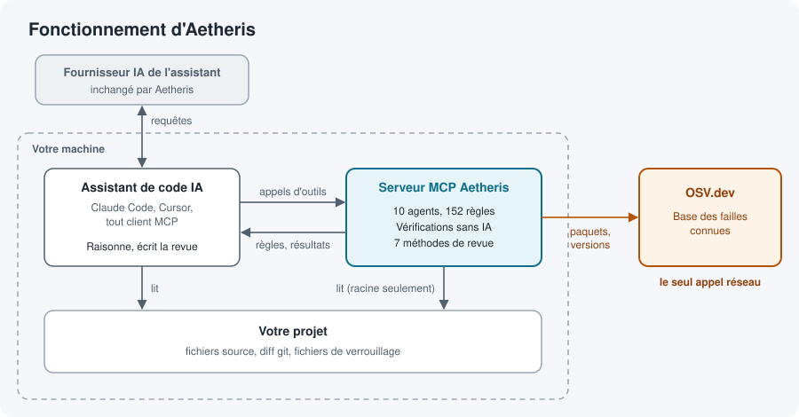
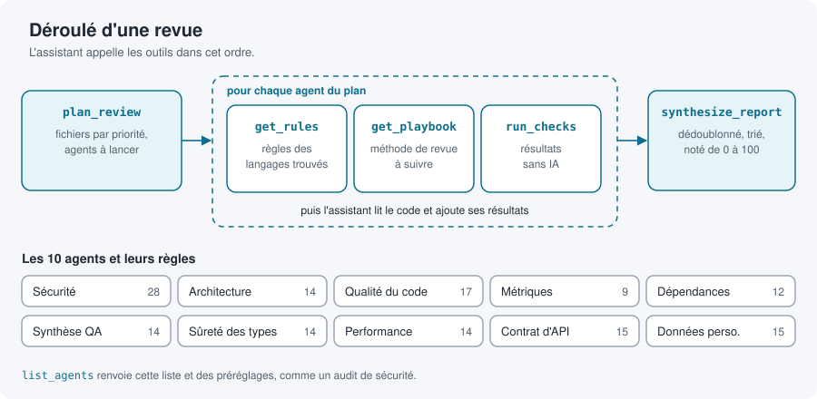
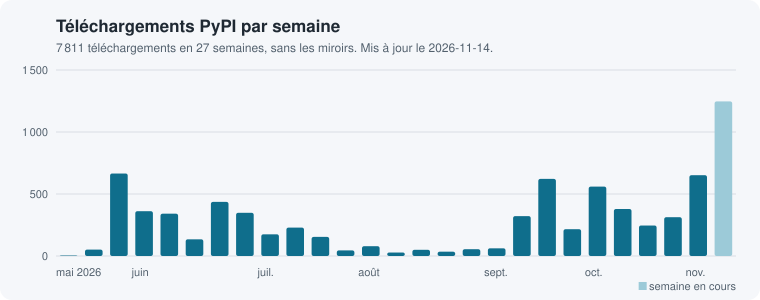

# Aetheris

Des règles de revue de code et des vérifications reproductibles pour votre assistant de code IA, servies par MCP. C'est votre assistant qui raisonne : Aetheris n'a besoin d'aucune clé d'API et ne coûte rien à faire tourner.

[](https://pypi.org/project/adryserage-aetheris/) [](https://pepy.tech/projects/adryserage-aetheris) [](https://pypistats.org/packages/adryserage-aetheris)

[Read in English](https://github.com/adryserage/aetheris/blob/main/README.md)

> La version 4.0 remplace l'outil en ligne de commande de la 3.x, qui appelait Gemini, OpenAI ou Claude avec votre propre clé d'API. Si vous l'utilisiez, lisez [Venir de la 3.x](#venir-de-la-3x).

## Ce qu'il fait

Demandez à Claude Code, à Cursor ou à n'importe quel client MCP de relire un changement : il peut appeler Aetheris pour deux types d'aide.

- Les règles de revue de 10 agents : sécurité, architecture, qualité du code, métriques, dépendances, typage, performance, contrats d'API, données personnelles, et synthèse QA, qui réunit les résultats des autres en un seul rapport. Chaque règle dit quoi chercher et quelle est sa gravité.
- Des vérifications sans IA : recherche de secrets, vulnérabilités connues de vos dépendances (base [OSV](https://osv.dev)), métriques des fichiers, code dupliqué et imports circulaires. Elles repèrent aussi les routes d'API que rien n'appelle, les appels vers des routes inexistantes, et des motifs de code pour la sécurité, le typage, la performance et les données personnelles. Elles rendent le même résultat à chaque fois.

Votre assistant choisit les outils à appeler, lit votre code et écrit la revue. Aetheris n'appelle jamais de modèle de langage.



## Installation

Aetheris tourne en local avec [`uvx`](https://docs.astral.sh/uv/). Il n'y a aucun compte à créer.

Le plus rapide l'ajoute à chaque client trouvé (Claude Code, Cursor, Claude Desktop) :

```bash
uvx --from adryserage-aetheris aetheris install
```

Ajoutez `--client cursor` pour viser un seul client, ou `--project` pour écrire la configuration du projet courant. `aetheris uninstall` le retire. Pour le configurer à la main :

### Claude Code

```bash
claude mcp add aetheris -- uvx adryserage-aetheris
```

### Cursor

Ajoutez ceci à `.cursor/mcp.json` dans votre projet, ou à `~/.cursor/mcp.json` :

```json
{
  "mcpServers": {
    "aetheris": {
      "command": "uvx",
      "args": ["adryserage-aetheris"]
    }
  }
}
```

### Autres clients MCP

Lancez `uvx adryserage-aetheris` comme serveur stdio.

Demandez ensuite à votre assistant, par exemple, « relis mes changements indexés avec Aetheris » ou « fais un audit de sécurité Aetheris de ce dépôt ».

## Outils

Aetheris expose six outils. Ensemble, ils forment le déroulé de revue que suit votre assistant.



| Outil | Ce qu'il rend |
|-------|---------------|
| `list_agents` | Les 10 agents (sécurité, architecture, qualité du code, métriques, dépendances, synthèse QA, typage, performance, contrat d'API, données personnelles) et les ensembles prédéfinis, comme un audit de sécurité |
| `plan_review` | Les fichiers à relire par ordre de priorité (votre diff git, des chemins donnés ou tout le dépôt), les langages trouvés, et les agents à lancer, chacun avec sa raison |
| `get_rules` | Les règles de revue d'un agent, au besoin pour un langage, et le schéma d'un résultat |
| `run_checks` | Les résultats des vérifications d'un agent : secrets, vulnérabilités connues (OSV), métriques, imports circulaires, et motifs de sécurité, de typage, de performance, d'API ou de données personnelles |
| `get_playbook` | Une méthode de revue à suivre, comme la revue différentielle d'un diff ou la vérification des faux positifs, adaptée des [Trail of Bits Skills](https://github.com/trailofbits/skills). `plan_review` et `get_rules` disent lesquelles s'appliquent |
| `synthesize_report` | Un rapport unique à partir de tous les résultats : doublons fusionnés, tri par gravité, comptes et score de 0 à 100 |

Les 10 agents portent 152 règles, rangées en fichiers YAML dans [`aetheris/rules/`](https://github.com/adryserage/aetheris/tree/main/aetheris/rules).

## Ce qui quitte votre machine

En mode local, Aetheris lit les fichiers de votre dossier de projet et n'envoie rien à aucun fournisseur d'IA. Le seul appel réseau est la vérification `osv_lookup` de l'agent des dépendances (`run_checks` avec `agent="dependency"`), qui envoie des noms de paquets et des versions à l'API d'OSV. Le fournisseur de votre assistant voit toujours ce que votre assistant lit, comme sans Aetheris.

## Contribuer

Les bogues et les idées vont dans les [GitHub Issues](https://github.com/adryserage/aetheris/issues). Les pull requests visent la branche `main`. Une amélioration des règles de revue compte autant qu'une amélioration du code.

## Versions

Aetheris suit le [versionnage sémantique](https://semver.org/lang/fr/). Chaque changement est listé dans [CHANGELOG.md](https://github.com/adryserage/aetheris/blob/main/CHANGELOG.md), et chaque version a son étiquette et sa [release GitHub](https://github.com/adryserage/aetheris/releases).

Les releases sont rares : le mainteneur en publie une quand un changement compte pour beaucoup d'utilisateurs. D'ici là, les changements fusionnés attendent sous `[Unreleased]`. Pour lancer la branche `main` actuelle au lieu de la dernière release :

```bash
uvx --from git+https://github.com/adryserage/Aetheris adryserage-aetheris
```

## Venir de la 3.x

La version 4.0 retire les commandes d'analyse, les intégrations des fournisseurs d'IA et le worker Railway. La commande `aetheris` reste, pour installer le serveur MCP. Les anciennes commandes comme `aetheris analysis` affichent ce qui a changé et sortent avec le code 2, pour qu'une CI échoue avec un message clair. Pour garder la CLI 3.x, fixez la dernière version 3.x :

```bash
pip install "adryserage-aetheris==3.0.0"
```

## Licence

Licence Apache 2.0. Voir [LICENSE](https://github.com/adryserage/aetheris/blob/main/LICENSE) et [NOTICE](https://github.com/adryserage/aetheris/blob/main/NOTICE).

Les playbooks de [`aetheris/playbooks/trailofbits/`](https://github.com/adryserage/aetheris/tree/main/aetheris/playbooks/trailofbits) sont adaptés des [Trail of Bits Skills](https://github.com/trailofbits/skills) et restent sous [CC BY-SA 4.0](https://creativecommons.org/licenses/by-sa/4.0/deed.fr). Chaque fichier nomme son auteur, sa source et ce qui a été modifié.

## Téléchargements

[](https://pepy.tech/projects/adryserage-aetheris)

Le graphique est redessiné chaque jour à partir de [pypistats.org](https://pypistats.org/packages/adryserage-aetheris), qui garde environ six mois d'historique. [pepy.tech](https://pepy.tech/projects/adryserage-aetheris) donne les totaux depuis la première version.
