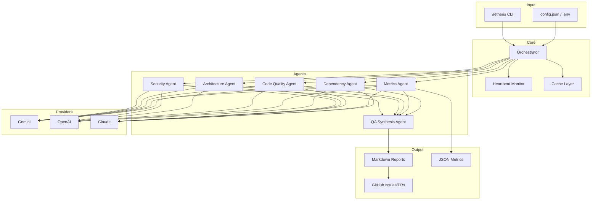

# Aetheris — AI Code Review That Actually Works

<p align="center">
  <strong>6 AI agents. 15+ vulnerabilities per codebase. 2 minutes instead of 2 hours.</strong>
</p>

<p align="center">
  <a href="https://badge.fury.io/py/adryserage-aetheris"></a>
  <a href="https://pepy.tech/project/adryserage-aetheris"></a>
  <a href="https://www.python.org/downloads/"></a>
  <a href="https://github.com/psf/black"></a>
  <a href="https://pypi.org/project/adryserage-aetheris/"></a>
</p>

<p align="center">
  <a href="#-get-started-in-30-seconds">Quick Start</a> |
  <a href="#-see-it-in-action">Demo</a> |
  <a href="#-architecture">Architecture</a> |
  <a href="docs/commands/README.md">Documentation</a>
</p>

---

<!-- ============================================================
     MARKETING SECTION — Why Aetheris?
     ============================================================ -->

## Help Shape Aetheris

**Should Aetheris become Open Source?** [Cast your vote](https://adryanserage.ca/poll/aetheris)

<p align="center">
  <a href="https://adryanserage.ca/poll/aetheris?vote=Yes%2C%20open%20source%20it!"></a>
  <a href="https://adryanserage.ca/poll/aetheris?vote=No%2C%20keep%20it%20private"></a>
  <a href="https://adryanserage.ca/poll/aetheris?vote=I%20don%27t%20mind%20either%20way"></a>
</p>

---

## Stop Shipping Bugs. Start Shipping Confidence.

**Your code reviews are broken.** Senior devs spend hours reviewing PRs. Junior devs miss critical bugs. Security vulnerabilities slip into production. Sound familiar?

**Aetheris fixes this.** It's like having a senior developer, security expert, and architect review every commit — in 2 minutes, not 2 hours.

| Your Pain Point | Aetheris Solution |
|:----------------|:------------------|
| "Code review takes forever" | **2-minute automated scans** |
| "We keep shipping the same bugs" | **Consistent, thorough reviews 24/7** |
| "Security audits are expensive" | **Built-in CVE + OWASP scanning** |
| "Junior devs miss edge cases" | **AI catches what humans miss** |
| "We're locked into [expensive tool]" | **Pay-per-use, switch providers anytime** |

```bash
pip install adryserage-aetheris && aetheris analysis
```

**That's it.** No account creation. No credit card. No 30-minute setup call.

---

## Trusted By Developers

<p align="center">
  <a href="https://pepy.tech/project/adryserage-aetheris"></a>
  <a href="https://pepy.tech/project/adryserage-aetheris"></a>
  <a href="https://pepy.tech/project/adryserage-aetheris"></a>
</p>

| Traditional Tools | Aetheris |
|:-----------------|:---------|
| Thousands of noisy warnings | **Actionable insights only** |
| Pattern matching (shallow) | **Context-aware AI (deep)** |
| Security OR quality OR architecture | **All 6 agents working together** |
| Suggestions you ignore | **Auto-fix that actually works** |

---

## Pricing That Makes Sense

**No subscriptions. No per-seat licensing. Just pay for what you use.**

| What You Get | Enterprise SaaS | Aetheris |
|:-------------|:---------------:|:--------:|
| Monthly cost (10 devs) | $200-500/mo | **$5-20/mo** |
| Your code stays... | On their servers | **With your AI provider** |
| Vendor lock-in | Yes | **Switch providers anytime** |
| Auto-fix capability | Suggestions only | **Actual code changes** |

### Real Cost Example (1,000 files)

| Provider | Economy Model | With 70% Cache |
|:---------|:-------------:|:--------------:|
| **Gemini Flash** | ~$3-10 | **~$1-3** |
| GPT-4o-mini | ~$5-15 | ~$2-5 |
| Claude Haiku | ~$10-20 | ~$3-6 |

> Smart caching skips unchanged files. Expect **60-80% cost reduction** on repeat analyses.
>
> **Pricing Note**: AI API pricing changes frequently. Check current rates: [Gemini](https://ai.google.dev/pricing) | [OpenAI](https://openai.com/api/pricing/) | [Anthropic](https://www.anthropic.com/pricing)

---

<!-- ============================================================
     TECHNICAL SECTION — How Aetheris Works
     ============================================================ -->

## Architecture

Aetheris coordinates 6 specialized AI agents through a central orchestrator. Each agent analyzes a specific domain, and the QA Synthesis agent consolidates findings into prioritized, actionable reports.



### 6 Specialized AI Agents

| Agent | Responsibility |
|:------|:---------------|
| **Security** | SQL injection, XSS, secrets in code, OWASP Top 10, weak crypto |
| **Architecture** | Coupling issues, circular dependencies, anti-patterns, layering violations |
| **Code Quality** | Dead code, complexity hotspots, edge cases, maintainability issues |
| **Metrics** | Cyclomatic complexity, duplication, maintainability index, LOC stats |
| **Dependency** | CVE scanning via OSV database, outdated packages, license compliance |
| **QA Synthesis** | Prioritizes findings, eliminates false positives, generates final report |

### Integration Points

| Integration | How It Works |
|:------------|:-------------|
| **AI Providers** | Gemini (default), OpenAI, Claude — switch with `--provider` flag |
| **GitHub** | Create issues from findings, review PRs, generate fix PRs |
| **CI/CD** | GitHub Actions template included, GitLab CI, Jenkins compatible |
| **Output Formats** | Markdown reports, JSON metrics, console summaries |

### New in v2.6.1 — Timeout & Incremental Analysis

**Timeout Management** for long-running analyses:
- **Configurable timeout**: `--timeout 30m`, `--timeout 2h`, or `--timeout 0` (unlimited)
- **Heartbeat monitor**: Progress indicator every 10 minutes for long operations
- **Graceful interruption**: Partial results saved when timeout is reached

**Incremental Reanalysis** (`--reanalyze` / `-r`):
- **Auto-detect changes**: Finds files modified since last analysis via git or timestamps
- **Efficient updates**: Only reanalyzes changed files, preserves previous results
- **Cost savings**: Reduces API calls by skipping unchanged files

```bash
# Run with 2-hour timeout (large codebases)
aetheris analysis --timeout 2h

# Reanalyze only files changed since last run
aetheris analysis --reanalyze

# Combine: reanalyze with custom timeout
aetheris analysis -r --timeout 30m

# Full workflow example
aetheris analysis                    # Initial full analysis
# ... make code changes ...
aetheris analysis -r                 # Quick reanalysis of changes only
```

<details>
<summary><strong>How Change Detection Works</strong></summary>

| Method | When Used | Detection |
|:-------|:----------|:----------|
| **Git-based** | When `.git` exists | `git diff` against last analyzed commit |
| **Timestamp** | No git available | File modification times vs last analysis |

The system reads the last analysis timestamp from `docs/metrics/metrics_*.json` and compares against current file states.

</details>

---

## See It In Action

```bash
# Analyze your entire codebase
$ aetheris analysis

  Scanning 127 files...
  Running 6 AI agents...

  CRITICAL: SQL injection in user_service.py:45
  HIGH: Hardcoded API key in config.py:12
  HIGH: N+1 query pattern in orders.py:78-92
  MEDIUM: Circular dependency: auth -> users -> auth

  23 issues found | 4 critical | 8 high | 11 medium
  Report: docs/analyses/quality_assurance_report.md

# Auto-fix with Claude Code
$ aetheris fix --analyze-first --auto
  Fixed 19/23 issues automatically
```

---

## Get Started in 30 Seconds

```bash
# 1. Install
pip install adryserage-aetheris

# 2. Configure (free Gemini API key: https://ai.google.dev)
echo "GEMINI_API_KEY=your_key" > .env
echo ".env" >> .gitignore  # IMPORTANT: Never commit API keys

# 3. Analyze
aetheris analysis
```

---

<!-- ============================================================
     REFERENCE SECTION — Commands, Config, Docs
     ============================================================ -->

## Complete Command Suite

| Command | Purpose | Example |
|:--------|:--------|:--------|
| `aetheris analysis` | Deep codebase scan | `aetheris analysis --reanalyze --timeout 30m` |
| `aetheris fix` | Auto-fix with Claude Code | `aetheris fix --analyze-first --auto` |
| `aetheris pr` | GitHub PR reviews | `aetheris pr --url <pr-url>` |
| `aetheris issues` | Create GitHub issues | `aetheris issues --labels security` |
| `aetheris user-story` | Flow analysis | `aetheris user-story --auto` |
| `aetheris pr-gen` | Generate fix PRs | `aetheris pr-gen --link-issues` |

### Analysis Command Options (v2.6.1)

| Option | Short | Description |
|:-------|:------|:------------|
| `--timeout` | | Set analysis timeout (`30m`, `2h`, `0` for unlimited) |
| `--reanalyze` | `-r` | Only analyze files changed since last run |
| `--changed-files-only` | | Analyze only specified files (requires `--files`) |
| `--files` | | Comma-separated list of files to analyze |

[Full command documentation](docs/commands/README.md)

---

## Works With Your Stack

<p align="center">
  <strong>Python</strong> | <strong>TypeScript</strong> | <strong>JavaScript</strong> | <strong>Go</strong> | <strong>Rust</strong> | <strong>Java</strong> | <strong>Kotlin</strong> | <strong>Swift</strong> | <strong>Dart/Flutter</strong> | <strong>C/C++</strong> | <strong>C#</strong> | <strong>PHP</strong> | <strong>Ruby</strong>
</p>

**AI Providers:** Gemini | OpenAI | Claude (Anthropic)

**CI/CD:** GitHub Actions template included | GitLab CI | Jenkins

---

## Roadmap

| Version | Status | What's New |
|:--------|:------:|:-----------|
| **v2.5** | Released | 6 core agents, GitHub Actions, auto-fix with Claude Code |
| **v2.6.1** | Released | Flexible timeout (`--timeout`), heartbeat monitor, incremental reanalysis (`--reanalyze`) |
| **v3.0** | In Progress | Persistent `config.json`, team-shareable settings |
| **v3.0.1** | Planned | 4 new agents: Performance, API Contract, Type Safety, Data Privacy |

---

## Documentation

| Getting Started | Reference | Advanced |
|:----------------|:----------|:---------|
| [Installation](docs/installation.md) | [Commands](docs/commands/README.md) | [Extending Agents](docs/PLUGINS.md) |
| [Configuration](docs/configuration.md) | [AI Providers](docs/ai-providers.md) | [GitHub Actions](docs/github-actions.md) |
| [Troubleshooting](docs/troubleshooting.md) | [Analysis Agents](docs/agents.md) | [Features Deep Dive](docs/features.md) |

---

## Important Safety Information

<details>
<summary><strong>Data Privacy Notice</strong></summary>

Aetheris sends your source code to third-party AI providers (Google Gemini, OpenAI, or Anthropic) for analysis. Before using on proprietary codebases:

1. **Review your organization's data policies** — Some companies prohibit sending source code to external services
2. **Use Enterprise/Zero Data Retention plans**:
   - [Google Vertex AI](https://cloud.google.com/vertex-ai) — Data not used for training
   - [OpenAI Enterprise](https://openai.com/enterprise) — Zero data retention
   - [Anthropic API](https://www.anthropic.com/api) — Data not used for training by default
3. **Check data residency requirements** — For regulated industries (healthcare, finance)

**Your API keys are never shared** — Aetheris connects directly to your chosen provider.

</details>

<details>
<summary><strong>Auto-Fix Safety Guidelines</strong></summary>

The `--auto` flag applies AI-generated code changes **without human review**. Risks include:

| Risk | Description |
|:-----|:------------|
| **Hallucinations** | LLMs may generate plausible but incorrect code |
| **Security vulnerabilities** | Fixes may introduce new attack vectors |
| **Business logic removal** | AI may delete critical code paths |

**Safe workflow:**
```bash
aetheris fix --analyze-first --auto  # Run fixes
git diff                              # Review ALL changes (mandatory)
pytest                                # Run tests
git add -p                            # Stage interactively
```

</details>

---

## Ready to Ship Better Code?

```bash
pip install adryserage-aetheris && aetheris analysis
```

<p align="center">
  <a href="https://pypi.org/project/adryserage-aetheris/"><strong>Install from PyPI</strong></a> |
  <a href="https://github.com/adryserage/aetheris"><strong>View on GitHub</strong></a> |
  <a href="https://ai.google.dev"><strong>Get Free Gemini API Key</strong></a>
</p>

---

<p align="center">
  <sub>Built with care by <a href="https://adryanserage.ca">Adryan Serage</a></sub>
</p>
