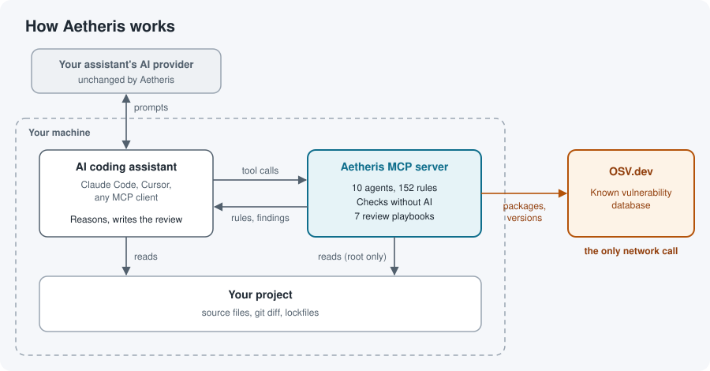
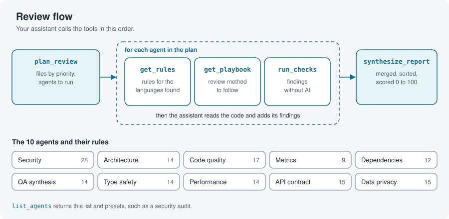

# Aetheris

Code review rules and reproducible checks for your AI coding assistant, served over MCP. Your assistant does the reasoning, so Aetheris needs no API key and costs nothing to run.

[Lire en français](https://github.com/adryserage/aetheris/blob/main/README.fr.md)

> Version 4.0 replaces the 3.x command-line tool, which called Gemini, OpenAI or Claude with your own API key. If you used it, read [Coming from 3.x](#coming-from-3x).

## What it does

Ask Claude Code, Cursor or any MCP client to review a change, and it can call Aetheris for two kinds of help:

- Review rules from 10 agents: security, architecture, code quality, metrics, dependencies, type safety, performance, API contracts, data privacy, and QA synthesis, which merges the findings of the others into one report. Each rule says what to look for and how severe it is.
- Checks that need no AI: secret scanning, known vulnerabilities in your dependencies (from the [OSV](https://osv.dev) database), file metrics, duplicated code and circular imports. They also find API routes that nothing calls, calls to routes that do not exist, and code patterns for security, typing, performance and personal data. They return the same result every time.

Your assistant chooses which tools to call, reads your code and writes the review. Aetheris never calls a language model.



## Install

Aetheris runs locally through [`uvx`](https://docs.astral.sh/uv/). There is no account to create.

The quickest way adds it to every client it finds (Claude Code, Cursor, Claude Desktop):

```bash
uvx --from adryserage-aetheris aetheris install
```

Add `--client cursor` to pick one client, or `--project` to write the current project's configuration. `aetheris uninstall` removes it. To set it up by hand instead:

### Claude Code

```bash
claude mcp add aetheris -- uvx adryserage-aetheris
```

### Cursor

Add this to `.cursor/mcp.json` in your project, or to `~/.cursor/mcp.json`:

```json
{
  "mcpServers": {
    "aetheris": {
      "command": "uvx",
      "args": ["adryserage-aetheris"]
    }
  }
}
```

### Other MCP clients

Run `uvx adryserage-aetheris` as a stdio server.

Then ask your assistant something like "review my staged changes with Aetheris" or "run an Aetheris security audit on this repository".

## Tools

Aetheris exposes six tools. Together they form the review flow your assistant follows.



| Tool | What it returns |
|------|-----------------|
| `list_agents` | The 10 agents (security, architecture, code quality, metrics, dependency, QA synthesis, type safety, performance, API contract, data privacy) and the preset agent sets, such as a security audit |
| `plan_review` | The files to review in priority order (your git diff, given paths, or the whole repository), the languages found, and the agents to run, each with its reason |
| `get_rules` | One agent's review rules, optionally for one language, and the schema of a finding |
| `run_checks` | Findings from one agent's checks: secrets, known vulnerabilities (OSV), metrics, circular imports, and security, typing, performance, API or personal data patterns |
| `get_playbook` | A review method to follow, such as a differential review of a diff or a false-positive check, adapted from [Trail of Bits Skills](https://github.com/trailofbits/skills). `plan_review` and `get_rules` say which ones apply |
| `synthesize_report` | One report from all findings: duplicates merged, sorted by severity, counted, and scored from 0 to 100 |

The 10 agents hold 152 rules, stored as YAML files in [`aetheris/rules/`](https://github.com/adryserage/aetheris/tree/main/aetheris/rules).

## What leaves your machine

In local mode, Aetheris reads files under your project directory and sends nothing to any AI provider. The only network call is the dependency agent's `osv_lookup` check (`run_checks` with `agent="dependency"`), which sends package names and versions to the OSV API. Your assistant's own provider still sees whatever your assistant reads, as it does without Aetheris.

## Contributing

Bug reports and ideas go to [GitHub Issues](https://github.com/adryserage/aetheris/issues). Pull requests target the `develop` branch. Improvements to the review rules are as welcome as code.

## Versions

Aetheris follows [semantic versioning](https://semver.org). Every change is listed in [CHANGELOG.md](https://github.com/adryserage/aetheris/blob/main/CHANGELOG.md), and every version has a tag and a [GitHub release](https://github.com/adryserage/aetheris/releases).

Releases are rare: the maintainer cuts one when a change matters to many users. Until then, merged changes wait under `[Unreleased]`. To run the current `main` branch instead of the last release:

```bash
uvx --from git+https://github.com/adryserage/Aetheris adryserage-aetheris
```

## Coming from 3.x

Version 4.0 removes the analysis commands, the AI provider integrations and the Railway worker. The `aetheris` command remains, to install the MCP server. Old commands such as `aetheris analysis` now print what changed and exit with code 2, so a CI job fails with a clear message. To keep using the 3.x CLI, pin the last 3.x release:

```bash
pip install "adryserage-aetheris==3.0.0"
```

## License

Apache License 2.0. See [LICENSE](https://github.com/adryserage/aetheris/blob/main/LICENSE) and [NOTICE](https://github.com/adryserage/aetheris/blob/main/NOTICE).

The playbooks in [`aetheris/playbooks/trailofbits/`](https://github.com/adryserage/aetheris/tree/main/aetheris/playbooks/trailofbits) are adapted from [Trail of Bits Skills](https://github.com/trailofbits/skills) and stay under [CC BY-SA 4.0](https://creativecommons.org/licenses/by-sa/4.0/). Each file names its author, its source and what was changed.
