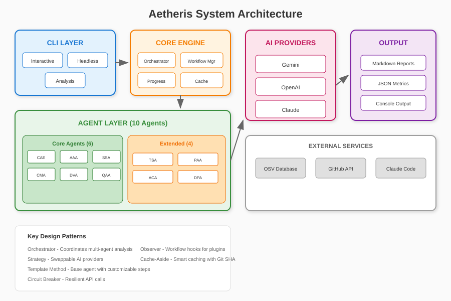
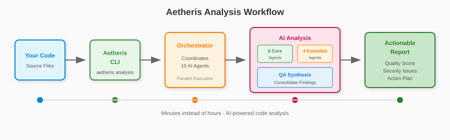
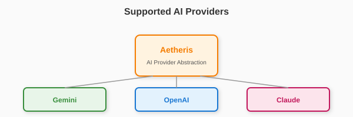
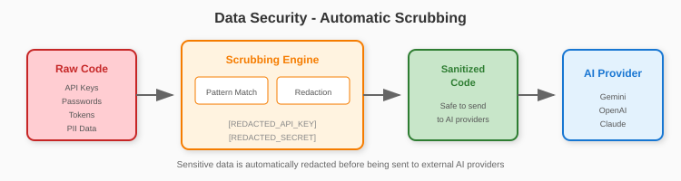
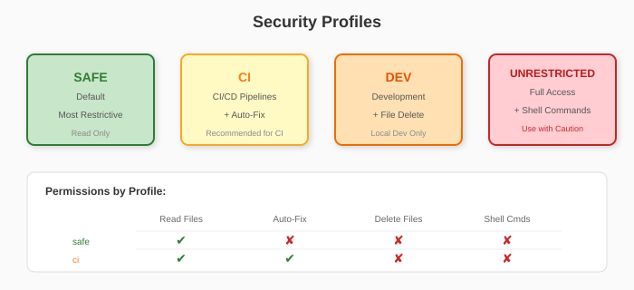

# Architecture Overview

Aetheris is a multi-agent AI code analysis system built with a modular architecture designed for extensibility, resilience, and maintainability.

## System Architecture



## Agent Workflow

The analysis follows a structured workflow where each agent performs its specialized analysis:



## Core Components

### 1. CLI Layer (`src/cli.py`)

The entry point for all user interactions:

| Mode | Description | Command |
|------|-------------|---------|
| **Analysis** | Full codebase scan | `aetheris analysis` |
| **Headless** | CI/CD automation | `aetheris run task.json` |
| **Interactive** | REPL interface | `aetheris --cli` |

### 2. Orchestrator (`src/core/orchestrator.py`)

Coordinates the entire analysis pipeline:

1. **Check Cache** - Load cached results if available
2. **Scan Files** - Identify files to analyze
3. **Filter by Patterns** - Apply include/exclude patterns
4. **Parallel Agent Dispatch** - Run agents concurrently
5. **Collect Results** - Aggregate findings
6. **QA Synthesis** - Consolidate and prioritize
7. **Generate Reports** - Output markdown and JSON
8. **Update Cache** - Store results for future runs

### 3. Agent System (`src/agents/`)

All agents inherit from `BaseAgent` and follow a consistent interface:

| Component | Description |
|-----------|-------------|
| `BaseAgent` | Abstract base with AI provider, config, analyze(), call_ai_with_retry() |
| `CoreAgents` | CAE, AAA, SSA, CMA, DVA, QAA |
| `ExtendedAgents` | TSA, PAA, ACA, DPA |

### 4. AI Provider Abstraction



The provider interface allows swapping between Gemini, OpenAI, and Claude without code changes.

## Data Flow

| Stage | Description |
|-------|-------------|
| **Input** | Source files, config, CLI arguments |
| **Processing** | File scanner → Content scrubber → Agent pipeline → Result aggregator |
| **Output** | Markdown reports, JSON metrics, GitHub issues |

## Security Architecture

### Pre-Processing (Scrubbing)

Before code is sent to AI providers, sensitive data is automatically redacted:



### Safety Profiles



## Key Design Patterns

| Pattern | Usage | Location |
|---------|-------|----------|
| **Orchestrator** | Coordinates multi-agent analysis | `src/core/orchestrator.py` |
| **Strategy** | Swappable AI providers | `src/core/ai_provider.py` |
| **Template Method** | Base agent with customizable steps | `src/agents/base_agent.py` |
| **Observer** | Workflow hooks for plugins | `src/core/workflow.py` |
| **Circuit Breaker** | Resilient API calls | `src/core/resilience.py` |
| **Cache-Aside** | Smart caching with Git SHA | `src/core/cache.py` |

## Extending Aetheris

### Adding a New Agent

1. Create agent class inheriting from `BaseAgent`
2. Implement `analyze()` method
3. Register in orchestrator
4. Add workflow stage

```python
from src.agents.base_agent import BaseAgent

class MyCustomAgent(BaseAgent):
    async def analyze(self, context: dict) -> Result:
        prompt = self._build_prompt(context)
        response = await self._call_ai_with_retry(prompt)
        return self._parse_response(response)
```

See [Plugin Guide](./PLUGINS.md) for detailed instructions.

## Performance Considerations

- **Parallel Execution**: Agents run concurrently where possible
- **Smart Caching**: Git SHA-based cache invalidation
- **Incremental Analysis**: `--reanalyze` flag for changed files only
- **Rate Limiting**: Built-in circuit breaker for API resilience
- **Progress Reporting**: Real-time Rich terminal progress bars

## Related Documentation

- [Agents Guide](./agents.md) - Detailed agent descriptions
- [Configuration](./configuration.md) - All configuration options
- [Plugin Guide](./PLUGINS.md) - Extending Aetheris
- [Headless Mode](./headless.md) - CI/CD integration
