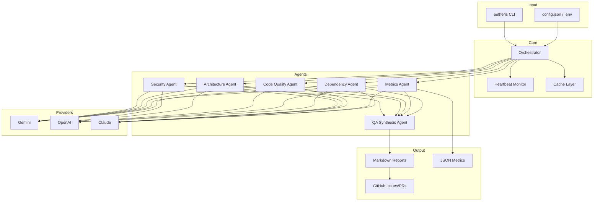

# Implementation Plan: README Restructure

**Branch**: `013-readme-restructure` | **Date**: 2026-01-08 | **Spec**: [spec.md](./spec.md)
**Input**: Feature specification from `/specs/013-readme-restructure/spec.md`

## Summary

Restructure README.md to clearly separate marketing content (top section with poll, stats, value proposition) from technical content (architecture diagram, agent descriptions, integration points). This improves first-impression conversion for new users while providing detailed technical context for architects and contributors.

## Technical Context

**Language/Version**: Markdown (GitHub Flavored Markdown)
**Primary Dependencies**: Mermaid (native GitHub support), shields.io badges, pepy.tech stats
**Storage**: N/A (documentation only)
**Testing**: Visual validation on GitHub, PyPI rendering check
**Target Platform**: GitHub README, PyPI project page
**Project Type**: Documentation
**Performance Goals**: N/A
**Constraints**: Must render correctly on GitHub, PyPI, and standard markdown viewers
**Scale/Scope**: Single file (README.md)

## Constitution Check

*GATE: Documentation-only change - no code impact*

| Gate | Status | Notes |
|------|--------|-------|
| No new dependencies | ✅ PASS | No code dependencies added |
| No breaking changes | ✅ PASS | Documentation only |
| Backward compatible | ✅ PASS | Same package functionality |

## Project Structure

### Documentation (this feature)

```text
specs/013-readme-restructure/
├── plan.md              # This file
├── spec.md              # Feature specification
├── checklists/
│   └── requirements.md  # Validation checklist
└── tasks.md             # Implementation tasks (generated by /speckit.tasks)
```

### Files to Modify

```text
README.md                # Main file to restructure
```

**Structure Decision**: Single file modification. The README will be reorganized into distinct sections without changing any code files.

## Content Structure

### New README Layout

```text
README.md
├── 1. Marketing Section (top ~40%)
│   ├── Title + Tagline
│   ├── Badges (version, downloads, python, platform)
│   ├── Navigation links
│   ├── Poll Section (prominent)
│   ├── Pain Point → Solution table
│   ├── Quick Install command
│   └── Social Proof (download stats, comparison table)
│
├── 2. Technical Section (~40%)
│   ├── Architecture Diagram (mermaid)
│   │   └── CLI → Orchestrator → 6 Agents → Reports
│   ├── Agent Descriptions table
│   ├── Integration Points
│   │   ├── AI Providers (Gemini/OpenAI/Claude)
│   │   ├── CI/CD (GitHub Actions)
│   │   └── Output formats
│   └── New in v2.6.1 (Timeout Management)
│
└── 3. Reference Section (~20%)
    ├── Commands summary
    ├── Configuration reference
    ├── Documentation links
    └── Safety information (collapsed)
```

## Mermaid Architecture Diagram



## Research Summary

No external research needed - uses existing README content with reorganization.

**Key decisions:**
- Poll section moved to top marketing area for maximum visibility
- Mermaid diagram chosen over static image for maintainability
- Collapsible sections for safety info to reduce visual clutter
- v2.6.1 timeout feature documented in technical section

## Next Steps

1. Generate tasks.md with `/speckit.tasks`
2. Implement README restructure following task list
3. Validate rendering on GitHub
4. Commit with conventional format
