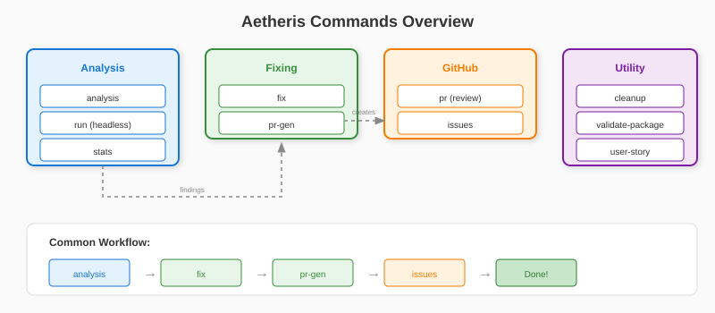

# Commands Reference

Aetheris provides several CLI commands for code analysis and automation.

## Command Overview



## Available Commands

| Command | Description | Documentation |
|---------|-------------|---------------|
| `aetheris analysis` | Full codebase analysis | [analysis.md](./analysis.md) |
| `aetheris run` | Headless execution for CI/CD (v2.8) | [run.md](./run.md) |
| `aetheris stats` | Statistics dashboard & ROI tracking | [stats.md](./stats.md) |
| `aetheris fix` | Fix bugs with Claude Code | [fix.md](./fix.md) |
| `aetheris pr` | Review GitHub Pull Requests | [pr-review.md](./pr-review.md) |
| `aetheris user-story` | Analyze user flows | [user-story.md](./user-story.md) |
| `aetheris issues` | Create GitHub issues from analysis | [issues.md](./issues.md) |
| `aetheris pr-gen` | Generate PRs with AI fixes | [pr-gen.md](./pr-gen.md) |
| `aetheris cleanup` | Remove artifacts before packaging | [cleanup.md](./cleanup.md) |
| `aetheris validate-package` | Pre-publication security check | [validate-package.md](./validate-package.md) |

## Quick Reference

```bash
# Get help for any command
aetheris --help
aetheris <command> --help

# Version
aetheris --version
```

## Common Workflows

### Full Analysis
```bash
aetheris analysis
```

### Incremental Analysis (v2.6.1)
```bash
# Reanalyze only files changed since last analysis
aetheris analysis --reanalyze

# Short form
aetheris analysis -r

# Combined with timeout for large codebases
aetheris analysis -r --timeout 30m
```

### Long-Running Analysis (v2.6.1)
```bash
# Set timeout (supports: 30m, 2h, etc.)
aetheris analysis --timeout 2h

# Unlimited timeout (no auto-termination)
aetheris analysis --timeout 0

# Heartbeat monitor runs automatically every 10 minutes
```

### Analyze and Fix
```bash
# --analyze-first: Run analysis before fixing (skips if recent analysis exists)
# --auto: Automatically apply fixes without confirmation prompts
aetheris fix --analyze-first --auto
```

### PR Review
```bash
# --url: GitHub PR URL to review (required)
aetheris pr --url https://github.com/owner/repo/pull/123
```

### Create Issues from Analysis
```bash
# Creates GitHub issues from the latest analysis report
aetheris issues
```

### Generate Fix PRs
```bash
# --link-issues: Link generated PRs to existing GitHub issues
aetheris pr-gen --link-issues
```

### Statistics & ROI (v2.6.5)
```bash
# View statistics dashboard
aetheris stats

# Filter by period
aetheris stats --period week
aetheris stats --period month

# Export to various formats
aetheris stats --export json
aetheris stats --export csv --output report.csv
aetheris stats --export md
```

### Pre-Release Validation (v2.6.2)
```bash
# Preview what would be cleaned
aetheris cleanup --dry-run

# Clean artifacts before packaging
aetheris cleanup --deep

# Validate package for secrets and excluded files
aetheris validate-package

# Auto-fix validation issues
aetheris validate-package --fix
```

### Language Configuration (v2.7)
```bash
# List available languages
aetheris --list-languages

# Run analysis in French
aetheris --lang fr analysis

# Run analysis in English (default)
aetheris --lang en analysis

# Set language via environment variable
export AETHERIS_LANG=fr
aetheris analysis
```

**Language Priority** (highest to lowest):
1. `--lang` CLI flag
2. `AETHERIS_LANG` environment variable
3. System locale detection
4. Default: English (en)

**Available Languages:**
| Code | Language |
|------|----------|
| `en` | English (default) |
| `fr` | Français |

### Agent Selection (v2.10)
```bash
# Run specific agents only
aetheris analysis --agents security,performance,type_safety

# Skip specific agents
aetheris analysis --skip-agents metrics,architecture

# Run all agents (default)
aetheris analysis --agents all

# Enable compliance frameworks for privacy analysis
aetheris analysis --compliance gdpr,hipaa

# Combine agent selection with compliance
aetheris analysis --agents data_privacy --compliance gdpr,pci_dss
```

**Available Agents:**

| Agent | Abbreviation | Description |
|-------|--------------|-------------|
| `code_analysis` | CAE | Individual file analysis |
| `architecture` | AAA | Architecture overview |
| `security` | SSA | Vulnerability detection |
| `metrics` | CMA | Code metrics and complexity |
| `vulnerability` | DVA | CVE scanning |
| `qa` | QAA | Final synthesis |
| `type_safety` | TSA | Type safety issues (v2.10) |
| `performance` | PAA | Performance anti-patterns (v2.10) |
| `api_contract` | ACA | REST API violations (v2.10) |
| `data_privacy` | DPA | PII and compliance (v2.10) |

**Compliance Frameworks:**
| Framework | Description |
|-----------|-------------|
| `gdpr` | EU General Data Protection Regulation |
| `hipaa` | US Health Insurance Portability Act |
| `pci_dss` | Payment Card Industry Data Security Standard |
| `ccpa` | California Consumer Privacy Act |

### Headless Mode (v2.8)
```bash
# Run task from JSON file
aetheris run task.json

# With CI profile (allows auto-fix)
aetheris run task.json --profile ci

# Dry run (validate only)
aetheris run task.json --dry-run

# Deterministic execution
aetheris run task.json --seed 42 --no-timestamps

# Output to file
aetheris run task.json --output-file result.json
```

**Security Profiles:**
| Profile | Auto-Fix | File Delete | Shell Commands |
|---------|:--------:|:-----------:|:--------------:|
| `safe` | No | No | No |
| `ci` | Yes | No | No |
| `dev` | Yes | Yes | Yes |
| `unrestricted` | Yes | Yes | Yes |

**Task File Example:**
```json
{
  "version": "1.0",
  "task": {
    "type": "analysis",
    "target": { "files": ["src/**/*.py"] },
    "options": { "timeout": "30m", "profile": "ci" }
  }
}
```

See [run.md](./run.md) and [headless.md](../headless.md) for complete documentation.

## Next Steps

- [Installation](/docs/installation.md) - Setup guide
- [Configuration](/docs/configuration.md) - Environment variables
- [AI Providers](/docs/ai-providers.md) - Provider configuration
