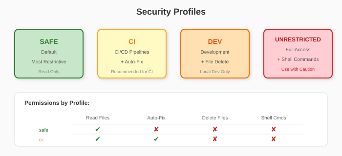

# Headless Mode (v2.8)

Aetheris supports headless (non-interactive) execution for CI/CD pipelines, automation scripts, and programmatic integrations.

## Overview

The headless mode allows you to:

- Execute tasks from JSON/YAML files
- Receive structured JSON output
- Run without any user interaction
- Achieve reproducible, deterministic results

## Quick Start

```bash
# Create a task file
cat > task.json << 'EOF'
{
  "version": "1.0",
  "task": {
    "type": "analysis",
    "target": { "files": ["src/**/*.py"] },
    "options": { "timeout": "30m" }
  }
}
EOF

# Run the task
aetheris run task.json
```

## CLI Reference

```
aetheris run <task-file> [options]

Arguments:
  task_file             Path to task file (JSON or YAML)

Options:
  -p, --profile         Security profile: safe, ci, dev, unrestricted
  --dry-run             Validate task file without executing
  -t, --timeout         Execution timeout (e.g., 30m, 2h, 0 for unlimited)
  --seed                Random seed for reproducibility
  --no-timestamps       Disable timestamps for deterministic output
  -v, --verbose         Enable verbose logging
  -o, --output-file     Write output to file instead of stdout
  --format              Output format: json (default) or yaml
```

## Task File Schema

### Complete Example

```json
{
  "version": "1.0",
  "task": {
    "type": "analysis",
    "target": {
      "files": ["src/**/*.py"],
      "changed_only": false,
      "exclude": ["**/test_*.py"]
    },
    "options": {
      "timeout": 1800,
      "profile": "ci",
      "agents": ["security", "quality"],
      "provider": "gemini",
      "verbose": false,
      "dry_run": false
    }
  },
  "output": {
    "format": "json",
    "include_diff": true,
    "include_logs": true,
    "file": "result.json"
  },
  "metadata": {
    "run_id": "build-123",
    "triggered_by": "github-actions"
  }
}
```

### Task Types

| Type | Description |
|------|-------------|
| `analysis` | Run code analysis with AI agents |
| `fix` | Apply fixes (requires CI or higher profile) |
| `stats` | Generate statistics |
| `cleanup` | Clean development artifacts |
| `validate-package` | Pre-publication security check |

### Target Configuration

| Field | Type | Description |
|-------|------|-------------|
| `files` | array/string | File paths or glob patterns |
| `changed_only` | boolean | Analyze only changed files |
| `exclude` | array | Patterns to exclude |

### Options

| Option | Type | Description |
|--------|------|-------------|
| `timeout` | int/string | Timeout in seconds or "30m", "2h", "0" |
| `profile` | string | Security profile (safe, ci, dev, unrestricted) |
| `agents` | array | Specific agents to run |
| `provider` | string | AI provider (gemini, openai, claude) |
| `verbose` | boolean | Enable verbose logging |
| `dry_run` | boolean | Validate without executing |

## Output Schema

### Success Response

```json
{
  "status": "success",
  "exit_code": 0,
  "duration_ms": 45230,
  "timestamp": "2026-01-11T12:30:45Z",
  "version": "2.8.0",
  "task": {
    "type": "analysis",
    "files_processed": 42,
    "source_file": "task.json"
  },
  "results": {
    "issues_found": 5,
    "critical": 0,
    "high": 2,
    "medium": 3,
    "low": 0,
    "reports": ["docs/analyses/quality_assurance_report.md"]
  },
  "logs": [
    "INFO: Starting task: analysis",
    "INFO: Security profile: ci",
    "INFO: Analysis completed successfully"
  ]
}
```

### Error Response

```json
{
  "status": "error",
  "exit_code": 1,
  "duration_ms": 150,
  "error": {
    "type": "file_not_found",
    "message": "Task file not found: task.json",
    "details": { "path": "task.json" }
  }
}
```

### Status Values

| Status | Exit Code | Description |
|--------|-----------|-------------|
| `success` | 0 | Task completed successfully |
| `error` | 1 | Task failed with error |
| `timeout` | 1 | Task exceeded timeout |
| `interrupted` | 1 | Task was interrupted (SIGINT/SIGTERM) |
| `blocked` | 1 | Operations blocked by security profile |

## Security Profiles



| Profile | Description | Auto-Fix | File Delete |
|---------|-------------|----------|-------------|
| `safe` | Most restrictive (default) | No | No |
| `ci` | CI/CD environments | Yes | No |
| `dev` | Development use | Yes | Yes |
| `unrestricted` | Full access | Yes | Yes |

## CI/CD Integration

### GitHub Actions

```yaml
- name: Run Aetheris Analysis
  run: |
    echo '${{ env.TASK_CONFIG }}' > task.json
    aetheris run task.json --profile ci --output-file result.json
  env:
    GEMINI_API_KEY: ${{ secrets.GEMINI_API_KEY }}
    TASK_CONFIG: |
      {
        "version": "1.0",
        "task": {
          "type": "analysis",
          "target": { "changed_only": true },
          "options": { "timeout": "30m" }
        }
      }

- name: Check Results
  run: |
    if jq -e '.exit_code != 0' result.json > /dev/null; then
      echo "Analysis found issues"
      jq '.results' result.json
      exit 1
    fi
```

### GitLab CI

```yaml
aetheris-scan:
  script:
    - aetheris run task.yaml --profile ci
  artifacts:
    paths:
      - result.json
    when: always
```

## Deterministic Execution

For reproducible results:

```bash
# Use seed and disable timestamps
aetheris run task.json --seed 42 --no-timestamps
```

This ensures:
- Same random choices with same seed
- No temporal metadata in output
- Comparable results across runs

## Error Handling

The headless mode always returns valid JSON, even on errors:

```bash
# Invalid task file
aetheris run invalid.json
# Returns: {"status": "error", "exit_code": 1, "error": {...}}

# File not found
aetheris run missing.json
# Returns: {"status": "error", "exit_code": 1, "error": {"type": "file_not_found", ...}}
```

## Examples

See `examples/tasks/` for sample task files:

- `analysis-full.json` - Complete analysis configuration
- `analysis-changed.yaml` - Incremental analysis in YAML
- `security-scan.json` - Security-focused scan

## Validation Only

To validate a task file without executing:

```bash
aetheris run task.json --dry-run
```

Returns success if valid, error if invalid.
