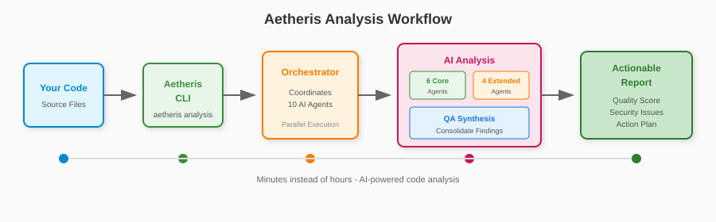

# Aetheris Documentation

**AI Code Review That Actually Works**

10 AI agents. Automated vulnerability detection. Minutes instead of hours.

## Quick Install

```bash
pip install adryserage-aetheris
echo "GEMINI_API_KEY=your_key" > .env
aetheris analysis
```

## What is Aetheris?

Aetheris is a multi-agent AI code analysis system that coordinates **10 specialized AI agents** to review your codebase for:

- **Security vulnerabilities** — SQL injection, XSS, hardcoded secrets, OWASP Top 10
- **Architecture issues** — Circular dependencies, coupling problems, anti-patterns
- **Code quality** — Dead code, complexity hotspots, maintainability issues
- **Dependencies** — CVE scanning, outdated packages, license compliance
- **Metrics** — Cyclomatic complexity, duplication, LOC statistics

## Why Aetheris?

| Traditional Tools | Aetheris |
|:-----------------|:---------:|
| Thousands of noisy warnings | **Actionable insights only** |
| Pattern matching (shallow) | **Context-aware AI (deep)** |
| Security OR quality OR architecture | **All 10 agents working together** |
| Suggestions you ignore | **Auto-fix that actually works** |

## How It Works



## Get Started

<div class="grid cards" markdown>

-   :material-download:{ .lg .middle } **Installation**

    ---

    Install Aetheris and configure your AI provider

    [:octicons-arrow-right-24: Installation Guide](installation.md)

-   :material-cog:{ .lg .middle } **Configuration**

    ---

    Configure AI providers, timeouts, and output formats

    [:octicons-arrow-right-24: Configuration](configuration.md)

-   :material-console:{ .lg .middle } **Commands**

    ---

    Learn all available CLI commands

    [:octicons-arrow-right-24: Commands Reference](commands/README.md)

-   :material-robot:{ .lg .middle } **AI Agents**

    ---

    Understand the 6 specialized analysis agents

    [:octicons-arrow-right-24: Agents Guide](agents.md)

</div>

## Features

- **Multi-Provider Support** — Gemini, OpenAI, Claude
- **Incremental Analysis** — Analyze only changed files with `--reanalyze`
- **Timeout Control** — Set analysis duration with `--timeout 30m`
- **Auto-Fix** — Fix issues automatically with Claude Code
- **GitHub Integration** — Create issues, review PRs, generate fix PRs
- **Smart Caching** — 60-80% cost reduction on repeat analyses

## Pricing

Aetheris uses AI providers' APIs on a pay-per-use basis. No subscription required.

| Project Size | Estimated Cost* |
|--------------|-----------------|
| Small (< 50 files) | $0.50 - $2 |
| Medium (50-200 files) | $2 - $10 |
| Large (200+ files) | $10 - $50 |

*Costs vary by provider and model. Smart caching reduces repeat analysis costs by 60-80%.

**Free Tier Options:**
- Google Gemini offers a generous free tier
- Cache unchanged files to minimize API calls

[View detailed pricing](./ai-providers.md#pricing)

## Links

- [GitHub Repository](https://github.com/adryserage/aetheris)
- [PyPI Package](https://pypi.org/project/adryserage-aetheris/)
- [Get Free Gemini API Key](https://ai.google.dev)
- [Report Issues](https://github.com/adryserage/aetheris/issues)
